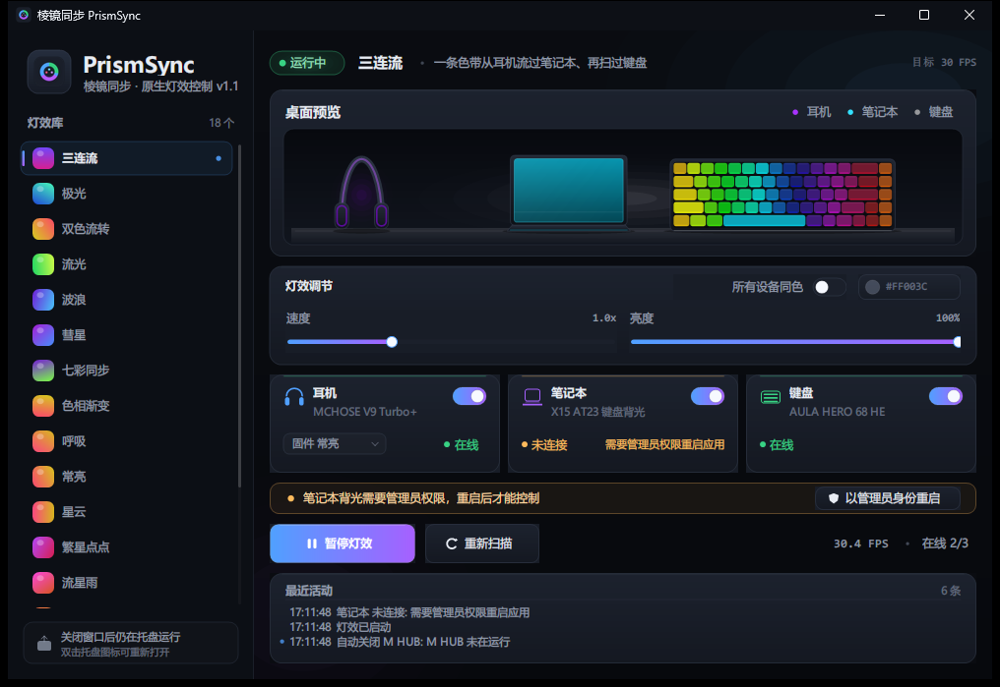

# PrismSync · 原生版说明

一句话：**一个 213 KB 的单文件原生 Windows 程序，替掉了原来的「Python + 本地网页」套壳**。
双击就能用，没有浏览器、没有 Python 运行时、不需要安装；关窗口自动缩到托盘，灯效继续。



---

## 一、快速开始

- 双击 **`PrismSync.exe`**（项目根目录，或桌面上的「PrismSync」快捷方式）。
- 第一次会弹 **UAC**：点是 → 笔记本背光也能一起控制；点否 → 键盘 + 耳机照常工作。
- 界面里选效果、拖速度/亮度 → 点「启动灯效」。
- **点窗口右上角 × 不会退出**：窗口隐藏到托盘，灯效继续跑。
  托盘图标右键：显示主界面 / 暂停灯效 / 关闭 M HUB / 退出。
- 所有设置（效果、速度、亮度、颜色、设备开关、耳机固件模式、窗口位置）自动记忆。

命令行调试参数（一般用不到）：

```
PrismSync.exe --no-elevate        不自动提权（笔记本显示"需要管理员权限"）
PrismSync.exe --no-devices        只开界面不碰设备（UI 调试）
PrismSync.exe --effect trio       指定启动效果
```

---

## 二、界面

| 区域 | 内容 |
|---|---|
| 左侧 | 18 个效果，每个带一个实时彩色缩略点；点击立即切换 |
| 右上 | **桌面实时预览**：耳机、笔记本、68 键键盘按真实键位绘制，30 fps |
| 中右 | 速度 / 亮度滑杆、颜色选择（仅常亮/呼吸可用）、「所有设备同色」开关 |
| 设备卡 | 耳机 / 笔记本 / 键盘：开关、在线状态、错误原因；耳机可选固件模式 |
| 底部 | 最近活动日志 |

单区设备（笔记本、耳机）在空间类效果里取"自己那一小段位置"的颜色，所以一条色带能从耳机 → 笔记本 → 键盘依次流过。

### 效果清单

| 效果 | 说明 |
|---|---|
| 三连流 / 极光 / 双色流转 / 流光 / 波浪 / 彗星 / 七彩同步 / 色相渐变 / 呼吸 / 常亮 | 从旧版移植并调过速度 |
| 星云 / 繁星点点 / 流星雨 / 焰火 / 涟漪 | 新的空间效果 |
| **击键涟漪** | 键盘输入用 Raw Input 捕获，敲哪个键从哪个位置扩散光波 |
| **屏幕氛围** | 每 200 ms 取一次屏幕 32×18 缩略色，桌面和键盘跟着画面变 |
| **音频律动** | 麦克风电平/低频/中频/高频驱动亮度与色相；没有麦克风时优雅降级为呼吸 |

> 屏幕/音频效果需要系统允许：屏幕采样走 GDI（无需权限）；麦克风第一次可能被 Windows 隐私设置拦，界面日志会提示。

---

## 三、三台设备与这次新摸清的东西

| 设备 | 通道 | 粒度 |
|---|---|---|
| 笔记本（七彩虹 X15 AT23 / Clevo NP50SNE） | `root\WMI` → `CLEVO_GET.SetKBLED(uint32)` | 单色，**需要管理员** |
| 键盘（狼蛛 HERO 68 HE） | HID `372E:103E`，接口 usage_page `0xFF60` | **68 键逐键** |
| 耳机（迈从 V9 Turbo+） | HID `3837:6008`，usage_page `0xFF00` | 单色，固件渲染 |

协议细节仍以 [`交接文档.md`](交接文档.md) 为准，这里只记本次新确认/修正的关键点：

### 1. 键盘其实是 68 键，不是 67

- 旧表漏了 **LED id 76（← 键）**；另外 **id 72 是 Fn 键**（固件不上报普通键值，所以按不到，但灯可以亮）。
- 用 `native\tools\keycal\键盘校准.exe` 逐颗点亮 + 用户按键完成校准，并与官方键位图逐行核对：
  5 行 **15 / 15 / 14 / 14 / 10 = 68** 键，右侧一列是 Ins / Del / PgUp / PgDn。
- 校准结果固化在 `native/src/Core/KeyLayout.cs` 的静态表里（也有一份 `native/keymap/keymap.json` 会被编进 exe）。

### 2. 耳机：`HidD_SetOutputReport` 是"假成功"

- 用耳机自己的 **`0x07` 状态查询**可以客观读回当前 RGB（回包 `00 AA 07 … [13..15]=RGB`）。
- 实测：
  - `HidD_SetOutputReport(65 字节)` → 返回 True、有 ACK，**颜色不变**；
  - `WriteFile(65 字节 = [0x00] + 64 字节报文)` → **真正生效**；
  - 63/64 字节的包一律不生效。
- 现在耳机统一走 `WriteFile`，写红读回 `255,0,40`、写蓝读回 `0,40,255`，已验证。
- 读写仍然用**同一个句柄**并由后台线程持续排空 ACK（旧结论不变）。

### 3. 键盘写入：为什么以前会闪

调试用的对比工具是 `native\tools\keytest\键盘写入测试.exe`（五种方式逐一点，静态彩虹不流动）。实测结论：

| 方式 | 现象 |
|---|---|
| `cmd 0x06`（一包 11 键）连续刷新 | **会闪**（即使纯白也会闪，颜色是对的） |
| `cmd 0x08` 整帧 **68 个色包** | 不闪，但**颜色不对**（固件单帧吃不下这么多包，尾部丢失） |
| `cmd 0x08` 整帧 **≤24 个色包** | **不闪且颜色正确**（本次采用的方案） |
| 只发一次然后停止 | 键盘**自己保持颜色不动**（固件有掉电/断流保持） |

最终实现：**cmd 0x08 / 每包一个颜色段 / 整帧提交 / 30 fps**，并在发送前用 HSV 调色板把整帧颜色自适应压到 **≤24 种**。
效果里的 2.5 圈彩虹会被量化成约 20 个色阶（相邻几颗键同色），换来完全稳定的显示；平均每帧 24 个包、约 2.5 ms 发完。

### 4. 笔记本

- 直接走 .NET `System.Management` 调 WMI（不再 spawn PowerShell 桥接进程）。
- 单次 `SetKBLED` 是毫秒级，所以适配器用"单槽位 + 后台线程"异步下发，丢中间帧不拖慢 30 fps。
- 非管理员时不会反复重试，只报「需要管理员权限重启应用」，点界面上的「以管理员身份重启」即可。

---

## 四、代码结构（`native/`）

```
native/
  build.ps1                     一键编译（系统自带 csc，无 SDK/NuGet）
  app.manifest                  启动清单（asInvoker + 系统 DPI）
  assets/app.ico                程序图标（tools/make_icon.py 生成）
  keymap/keymap.json            68 键校准结果（会被嵌进 exe）
  src/
    Program.cs                  单实例（跨权限 ACL）、自提权、托盘/窗口生命周期
    App/
      AppController.cs          状态机：设置、引擎、设备、服务、快照
      DeviceHost.cs             设备探测/打开/重试/关闭
      Settings.cs               %APPDATA%\PrismSyncSync\settings.json
      TrayController.cs         托盘图标与菜单
      AdminCheck.cs
    Core/
      Engine.cs                 统一 30 fps 时钟、效果渲染、预览快照
      Rgb.cs / Frame.cs         颜色与一帧数据（68 键 + 两个单区）
      IEffect.cs                效果接口、空间效果基类、击键状态
      Effects.cs                18 个效果实现
      EffectRegistry.cs         效果目录 + 工厂
      KeyLayout.cs              68 键物理表（LED id / 行 / 宽度 / 位置 / usage）
      UsageLayout.cs            标准 68 键位图（校准工具用）
    Devices/
      HidNative.cs              setupapi + hid.dll 的 P/Invoke（枚举/读写/排空）
      Hero68Device.cs           键盘：cmd 0x08 整帧 + HSV 量化 ≤24 色
      MchoseDevice.cs           耳机：WriteFile(65) + ACK 排空 + 0x07 读回
      ClevoDevice.cs            笔记本：WMI 单槽位异步
      IDeviceAdapter.cs
    Capture/
      ScreenSampler.cs          32×18 屏幕采样（GDI DIB，后台线程）
      AudioMeter.cs             winmm waveIn + 频段能量/节拍
      KeyPressMonitor.cs        Raw Input 全局键盘监听
    UI/
      MainForm.cs               主窗口（26 fps → 20 fps 静态缓存 + 动态重绘）
      DesktopPreview.cs         桌面三设备预览
      Widgets.cs                滑杆/开关/色块/按钮/日志面板等自绘控件
      DeviceCard.cs / EffectList.cs / Theme.cs
  tools/
    keycal/键盘校准.exe          68 灯逐颗校准（F1 跳过 / F2 重做 / F3 保存）
    keytest/键盘写入测试.exe     5 种写入方式对比（排障用）
    shot.ps1                    启动 + PrintWindow 截图
    make_icon.py                生成图标
    (其余为协议验证/性能测试小工具)
```

构建：

```powershell
pwsh -NoProfile -ExecutionPolicy Bypass -File native\build.ps1
# 产物：native\dist\PrismSync.exe，同时自动复制到项目根目录
```

> ⚠ 必须用 **PowerShell 7（pwsh）** 执行；Windows PowerShell 5.1 会把无 BOM 的 UTF-8 脚本按 GBK 解码，中文路径/字符串会坏（这是旧项目踩过的坑）。

---

## 五、验证结果（本机实测）

| 项 | 结果 |
|---|---|
| 体积 | 单 exe **约 218 KB**（.NET Framework 4.8 为系统自带） |
| 帧率 | 引擎 30 fps（界面显示 30.4–30.5），键盘写入 ≈2.5 ms/帧 |
| CPU | 三设备 + 桌面预览运行：**约 3.3%**（单核百分比，8 秒均值） |
| 内存 | 工作集约 **60 MB**，私有约 43 MB |
| 键盘 | 整帧 ≤24 色包，无失败；68 键映射经人工校准 |
| 耳机 | `0x07` 读回颜色随写入变化（红/蓝/效果色均验证） |
| 关闭行为 | 关窗口→隐藏到托盘、进程与灯效继续；托盘退出→释放设备 |
| 单实例 | 重复双击→通知已有实例显示窗口；跨管理员/普通权限也能识别 |

---

## 六、已知限制 / 可继续做

- 耳机如果选「固件模式」（呼吸/繁星/循环/随波），它跑自己的动画，不和另外两台同步（常亮模式才逐帧跟效果）。
- 「音频律动」用麦克风而不是系统回环（不依赖额外组件）；第一次需要允许麦克风。
- 「屏幕氛围」每 200 ms 采一次屏幕（约 15 ms/次），不占渲染线程，但不是逐帧实时。
- 笔记本背光必须管理员；不点 UAC 就只能控制键盘+耳机。
- 未做开机自启（需要的话可以加注册表 Run 或计划任务，但会每次开机弹 UAC）。
- 旧版 Python/HTML 代码（`gui/`、`rgbsync/`、`README.md` 前半部分）**保留作为协议档案**，不再是默认入口；需要时仍可 `python gui\launch.py` 运行旧版。
- 键盘 24 色量化对「三连流」这类大跨度彩虹有轻微色阶感；如果以后更看重平滑度，可以再试「键盘 15 fps + 更多色阶」的取舍。
